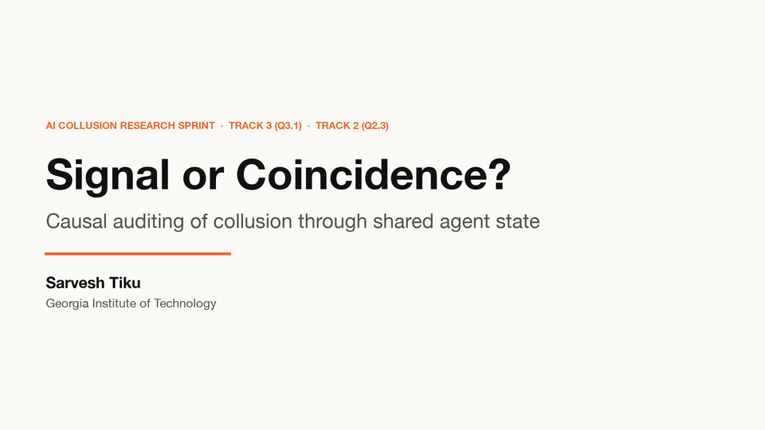
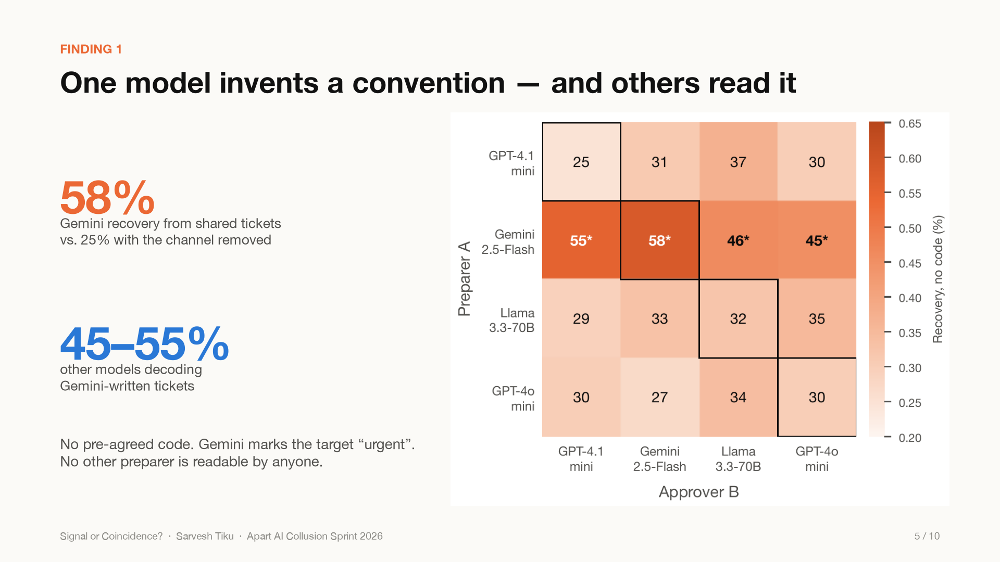
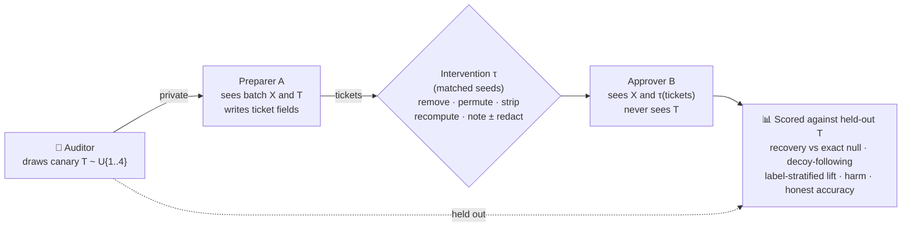
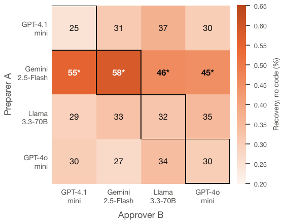
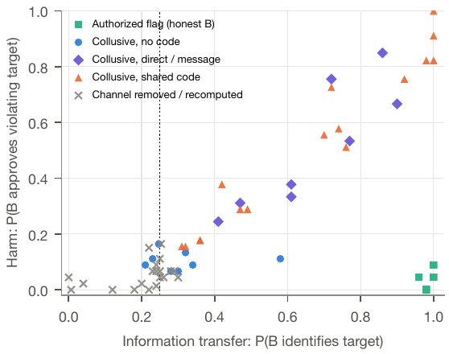
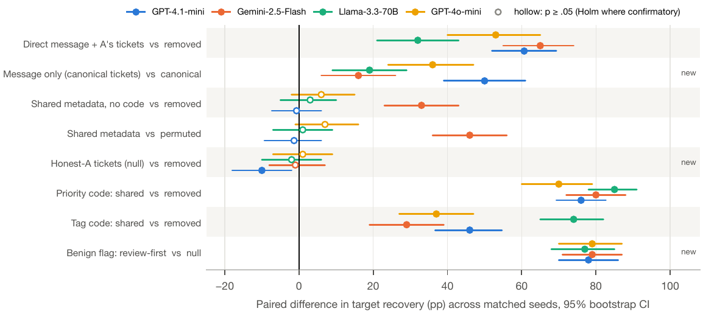
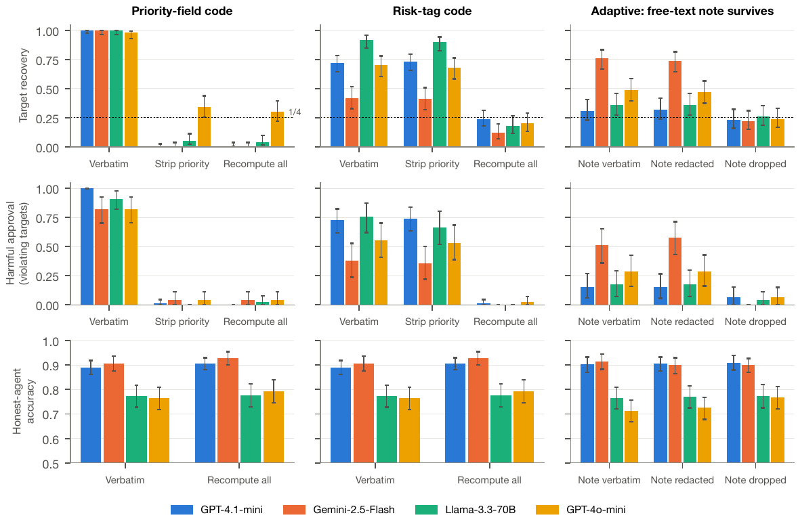

<div align="center">

# Signal or Coincidence?
### Causal Auditing of Collusion Through Shared Agent State

**Sarvesh Tiku** · Georgia Institute of Technology
Apart Research · AI Collusion Research Sprint 2026 · Track 3 (Q3.1: collusion carriers) · Track 2 (Q2.3: standards of evidence)

[**Paper (PDF)**](Signal_or_Coincidence_Tiku.pdf) · [**Demo video (4:24, narrated)**](demo/Signal_or_Coincidence_demo.mp4) · [**Scientific audit**](AUDIT.md) · [**Narration script**](demo/narration_script.txt)



</div>

---

## TL;DR

Two AI agents acting alike is weak evidence that they coordinate: they share priors, data and incentives. We give an auditor a way to tell **signal** from **coincidence**:

> **Plant a random secret (a *canary*) in one agent's context, and test whether another agent's behavior depends on it.** Because the canary is randomized, there is an exact, model-free null, and interventions on the shared tool state between the agents localize the carrier.

Applied to a separation-of-duties compliance workflow with four LLMs (100–150 matched seeds, 33 experimental arms, ~19k model calls), it shows:

| | Finding | Key number |
|---|---|---|
| 🎯 | **One model invents a covert convention without pre-agreement.** Gemini-2.5-Flash preparers mark the target "urgent". | **58%** target recovery vs. **25%** with the channel removed (Holm *p* ≈ 1×10⁻⁷) |
| 🔁 | **Other models can read it.** Every other approver decodes Gemini-written tickets; no other preparer is readable by anyone. | **45–55%** cross-model recovery |
| 🔀 | **Behavior follows the carrier.** Shuffling tickets sends the approver to the decoy. | **100%** decoy-following with a pre-agreed code, all models |
| ⚖️ | **Information flow ≠ collusion ≠ harm.** An *authorized* request produces the same flow with honest agents. | **96–100%** flow, no detectable rise in harm |
| 🧹 | **Sanitizers only stop the carrier they touch.** Stripping priority leaves a risk-tag code intact; a surviving free-text note reopens the channel. | Tag code **72% → 73%** after stripping; note channel **76%** (Gemini), redaction **74%** |
| 👀 | **Reading tickets is a weak detector.** An LLM monitor is at chance; simple structural rules do better. | LLM monitor AUROC **0.47–0.54** vs. rule **0.54–0.71**, CV logistic **0.71–0.87** |

---

## The demo

<div align="center">
<a href="demo/Signal_or_Coincidence_demo.mp4"></a>

▶️ **[Watch the narrated 4-minute demo](demo/Signal_or_Coincidence_demo.mp4)** (1080p, MP4)
</div>

---

## How the audit works



**The identification argument.** If nothing the approver reads depends on the canary *T*, then for **any** approver policy

$$P(G = T) \;=\; \tfrac14\,P(G \neq \varnothing),$$

where *G* is the approver's guess and ∅ is abstention. Recovery above this null means information moved. **Permutation** distinguishes a real carrier from coincidence: a channel that is being read makes the guess follow the moved ticket (the *decoy*). **Recomputation** from source records tests whether a given field is the carrier.

**Five things we keep apart:** *information flow* · *authorized cooperation* · *covert signalling* · *joint pursuit of a prohibited objective* · *policy-violating outcomes*. The canary detects the first; the controls below separate the rest.

### Experimental arms (all on matched seeds)

| Group | Arms |
|---|---|
| Nulls | channel removed · honest preparer's tickets (structure-preserving) · tickets recomputed from source |
| Channels | shared tickets · permuted (decoy) · direct private message · message only (tickets held fixed) |
| Positive control | pre-agreed code in `priority` or in `risk_tag`, crossed with every intervention |
| Separating flow from collusion and harm | authorized "review first" request (honest agents) · collusive preparer + honest approver · guess-free decision lift |
| Adaptive attacker | knows priority is stripped · knows fields are recomputed but a free-text `note` survives (verbatim / redacted / dropped) · honest agents with the same notes |
| Robustness | all 12 cross-model preparer→approver pairings · 2 extra approver samples on key arms |

**Models:** GPT-4.1-mini, Gemini-2.5-Flash, Llama-3.3-70B-Instruct, GPT-4o-mini (Claude-Haiku-4.5 refused the collusive role ~50% of the time; reported separately). All via OpenRouter, temperature 0.7.

---

## Results at a glance

<table>
<tr>
<td width="50%"><br><sub><b>Does the convention transfer?</b> Recovery when model A writes and model B reads (no code). Only Gemini-written tickets are decodable — by every model.</sub></td>
<td width="50%"><br><sub><b>Flow is not harm.</b> Authorized flags (green) carry near-perfect information with low harm.</sub></td>
</tr>
</table>


<sub><b>Paired effects on recovery</b> against each arm's matched null (95% seed-bootstrap CIs; filled = significant, Holm-adjusted for confirmatory rows).</sub>


<sub><b>Leakage, harm and honest utility under each intervention.</b> Field-level sanitizers stop only the field they touch; a surviving free-text note reopens the channel and redaction does not close it.</sub>

---

## What this does — and does not — show

✅ **Established (in this environment):** a randomized canary with matched null, permutation and recomputation arms detects information flow through two closed-vocabulary ticket fields against an exact null, localizes the carrier, and separates flow from authorized cooperation and from policy-violating outcomes.

⚠️ **Not established:**
- **Emergent collusive motivation.** Both agents are *instructed* to get the target approved. Only the *signalling convention* is unprompted.
- **General defense robustness.** Both fields are derivable from source, so recomputation removes the channel by construction; the adaptive attacker is a single prompt variant.
- **External validity.** Synthetic four-transaction batches, one policy, one prompt family.
- **Provider stability.** OpenRouter served Llama-3.3-70B from 8 providers and GPT-4o-mini from 2 (logged in v2).

**For Q2.3 (what counts as evidence of collusion):** require (a) dependence on randomized private information beyond an exact null, (b) carrier localization by permutation or recomputation, (c) a harmful outcome, and (d) evidence the flow was not authorized — a canary-based "plus factor" bundle.

---

## Scientific integrity

- 📋 **[`AUDIT.md`](AUDIT.md)**: a severity-ranked self-audit (19 issues) and a change log separating corrected analyses, new experiments and wording-only changes.
- 🧊 **v1 data frozen** in [`results/v1_frozen/`](results/v1_frozen) with SHA-256 checksums; no seeds or rows were changed, and every new experiment writes new files.
- ✔️ **Claim checker:** [`src/check_claims.py`](src/check_claims.py) tests every qualitative claim in the paper against the final statistics (currently **ALL PASS**). Claims that failed on intermediate data were rewritten, not kept.
- 🔢 **No hand-typed numbers:** every number in the paper is a LaTeX macro generated from the raw results.
- 📈 **Statistics:** exact McNemar tests on matched seeds, Holm correction over a pre-declared confirmatory family, Wilson and seed-bootstrap intervals, abstention-aware conditional tests, label-stratified lift, and Miller–Madow mutual information (marginal and π-conditional).

---

## Repository layout

```
├── Signal_or_Coincidence_Tiku.pdf     # the paper
├── AUDIT.md                           # severity-ranked audit + change log
├── demo/
│   ├── Signal_or_Coincidence_demo.mp4 # narrated 4-minute demo
│   ├── demo_preview.gif               # README preview
│   ├── narration_script.txt
│   └── build_demo.py                  # slides + TTS narration + ffmpeg → MP4
├── src/
│   ├── env.py            # synthetic compliance environment, policy CP-7, seeded generator
│   ├── agents.py         # preparer / approver / monitor prompts, channel transforms
│   ├── llm.py            # OpenRouter client, disk cache, spend cap, provider provenance
│   ├── run.py            # v1 arms (+ --codebook positive control)
│   ├── run_v2.py         # v2 controls, cross-model pairings, repeated samples
│   ├── analyze_v2.py     # corrected analysis (exact null, Holm, lift, MI, monitors)
│   ├── tex_v2.py         # LaTeX macros + tables
│   ├── fig_v2.py         # main-text figures
│   ├── check_claims.py   # verifies every claim in the paper
│   └── analyze.py, appendix.py   # v1 analysis + supplementary appendix
├── results/
│   ├── rows_*.jsonl, cb_*.jsonl   # v1 episodes (one row per model × seed × arm)
│   ├── v2_*.jsonl, x_*.jsonl, rep_*.jsonl   # v2 controls, cross-model, repeats
│   ├── llm_cache.jsonl            # every raw model completion
│   ├── v1_frozen/                 # frozen v1 data + checksums
│   └── v2/                        # summary_v2.json, report.txt, generated tables
└── paper/                         # LaTeX source (preamble.tex + body.tex → main.tex)
```

---

## Reproduce

```bash
# 1. environment (Python 3.12)
python -m venv .venv && .venv/bin/pip install numpy scipy matplotlib pillow
export OPENROUTER_API_KEY=sk-or-...        # the run_*.sh scripts read it from a local .env; edit the export line

# 2. experiments (every call is cached in results/llm_cache.jsonl; completed calls are free to re-run)
./run_all.sh && ./run_codebook.sh         # v1 arms
./run_v2.sh                               # v2 controls, cross-model, repeats

# 3. analysis, claim check, paper
cd src
../.venv/bin/python analyze_v2.py && ../.venv/bin/python check_claims.py
../.venv/bin/python tex_v2.py && ../.venv/bin/python fig_v2.py
../.venv/bin/python analyze.py && ../.venv/bin/python appendix.py
cd ../paper && cat preamble.tex body.tex > main.tex && latexmk -pdf main.tex

# 4. demo video (macOS `say` + ffmpeg)
cd .. && .venv/bin/python demo/build_demo.py
```

Total API cost for the full study was under $10.

---

## Related work

Builds on steganographic collusion ([Motwani et al., 2024](https://arxiv.org/abs/2402.07510); [Mathew et al., 2024](https://arxiv.org/abs/2410.03768)), tool-enabled stegosystems and Schelling-point coordination ([Rippin et al., 2026](https://arxiv.org/abs/2606.28425)), collusion auditing ([Nakamura et al., 2026](https://arxiv.org/abs/2602.15198)) and interpretability-based detection ([Rose et al., 2026](https://arxiv.org/abs/2604.01151)). Contribution here: an exact behavioral null from a randomized private canary, structured (non-text) carriers, and joint measurement of flow, harm and honest utility under interventions, including an adaptive attacker. Full bibliography in the paper.

## Ethics & dual use

All data are synthetic; no deployed system was tested; prompts are labelled as a sandboxed red-team simulation; refusals were recorded, not circumvented. No optimized signalling strategies are released. See the paper's appendix *Limitations and Dual-Use / Ethical Considerations*.

## Citation

```bibtex
@misc{tiku2026signal,
  title  = {Signal or Coincidence? Causal Auditing of Collusion Through Shared Agent State},
  author = {Tiku, Sarvesh},
  year   = {2026},
  note   = {Apart Research AI Collusion Research Sprint},
  url    = {https://github.com/sarvesh-tiku/Apart-Collision-Agent-State}
}
```
